> 🌐 **Fenton Lab official website:** [fentonlabai.com](https://fentonlabai.com/)

# Fenton Lab

### Distinct, character-driven companion software that respects your boundaries.

**Sprocket Desktop**, an animated fox companion for Windows: *our first release priority*
**Sprocket Family**, a learning companion for ages 7–12: *working prototype*
**Liberty, The Desktop Eagle**: *early development*

**🟠 Sprocket: Coming Soon. Windows release in preparation. Release date to be confirmed.**

[Desktop](#sprocket-desktop-a-windows-companion) · [Family](#sprocket-family-a-learning-companion-for-ages-712) · [Liberty](#liberty-the-desktop-eagle) · [Screenshots](#screenshots) · [Privacy](#local-first-by-design) · [Learning Library](#learning-library-and-study-plans) · [Progress](#development-milestones) · [Follow](#follow-development)

---

## About Fenton Lab

Fenton Lab develops **distinct, character-driven companions** for the desktop. Each has its own identity and personality and pairs it with genuinely useful features and permissions the user controls.

- **Sprocket**, a small, curious fox, is our first character and **first release priority**. She comes in two editions: Desktop and Family.
- **Liberty**, a focused desktop eagle, is our second, **in early development**.

All our companions follow the same principles:
- a character's personality never gives it extra access;
- your data stays on your computer unless you choose otherwise;
- we don't call a feature finished until it has been tested.

[How we build them](docs/ENGINEERING_APPROACH.md)

## Sprocket Desktop: a Windows companion

Sprocket lives on your Windows desktop. She moves, reacts, chats in a small **Comm-Link** window, and helps with documents **you choose to show her**.

| | Working in the current pre-release build | Not yet released |
| --- | --- | --- |
| 🦊 **Character** | An animated desktop fox you can drag around, with idle behaviour, looking around and reactions while you chat | New character art and motions are being prepared |
| 💬 **Chat** | Comm-Link chat with a local AI model (Ollama) running on your own PC. With no model set up she stays in **Offline mode and makes no AI calls** | Any cloud AI provider would be optional and off by default, and is still under review for the release |
| 🧠 **Memory** | Conversation history and saved notes stored locally, with verified safety backups | |
| 📁 **Files** | Read-only reading of a file or folder you pick. A file path typed into the chat is never treated as permission | |
| 🧰 **Pocket Workshop** | Built-in gauges show how full the chat's memory is and what Sprocket is doing | Optional add-on devices, tools and animations are in development |
| 🔄 **Updates** | Verified update and recovery system, tested only on an isolated development copy | Not deployed. Signing and real-installer testing are still to do |

## Sprocket Family: a learning companion for ages 7–12

Sprocket Family is a **working development prototype**, currently in owner testing. A parent sets everything up; the child learns alongside Sprocket. **It runs entirely offline: no internet, no cloud AI, no ads and no purchases.**

What we've built and tested so far:
- **Parent controls:** child profiles that use nicknames only, a parent PIN, a daily time limit and required breaks for each child, and a choice of which subjects each child can use.
- **Learning activities:** reading, math, science and beginner coding (programming a path across a small board), plus step-by-step homework help that guides the child without giving away answers.
- **Offline content:** every lesson and question is reviewed and built into the app. Nothing is generated by an AI.
- **A teaching companion:** Sprocket reacts to what's happening in the lesson. She looks at the question, celebrates a right answer, encourages after a wrong one, and rests during breaks.
- **Local progress:** stars and progress records are saved only on the family's computer. Chat text is never stored, and a parent can export or delete a child's data.
- **Learning Library:** parent-approved study plans, with a first fractions package ([details below](#learning-library-and-study-plans)).

**Not available yet:**
- Sprocket Family is **not released, not available for download, and not certified as child-safe**.
- It has no general-purpose AI chat: the child edition's conversation is offline and pattern-based.
- Child-safety, privacy and accessibility reviews are still to come before any release.

## Screenshots

Taken from real running development builds on October 16, 2026, using demo profiles. The character artwork is still under rights review, so these images show **the app's screens only**. Sprocket herself (and her speech bubble) is cropped out.

### Sprocket Family

<table>
<tr>
<td width="50%">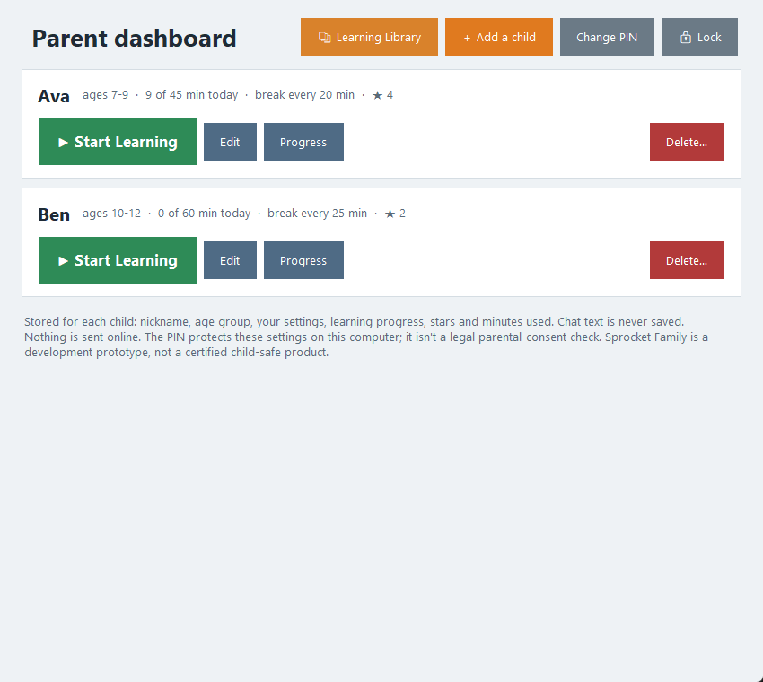 Parent dashboard: child profiles, time limits and breaks</td>
<td width="50%">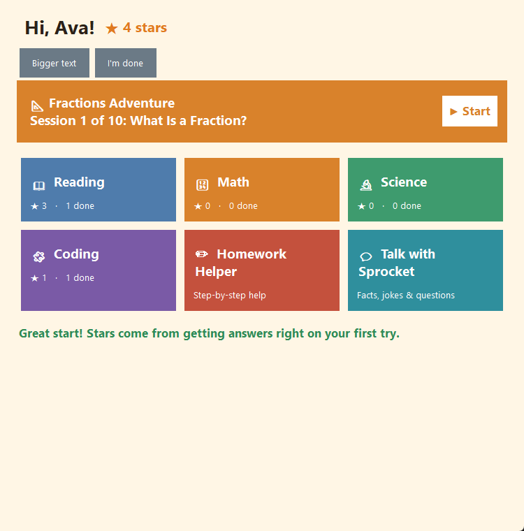 A child's home screen, with a parent-approved study plan at the top</td>
</tr>
<tr>
<td>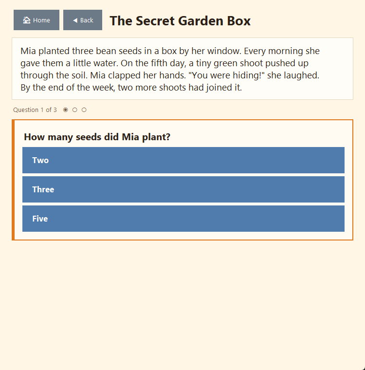 A reading lesson with a question</td>
<td>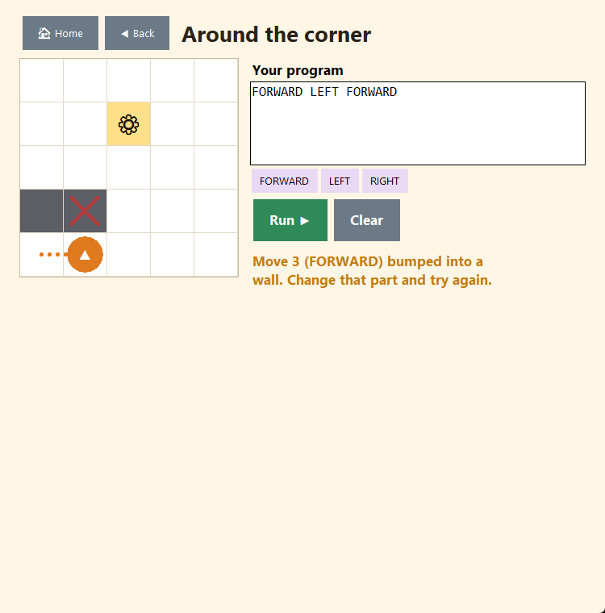 Beginner coding: the board shows exactly where a program went wrong</td>
</tr>
<tr>
<td>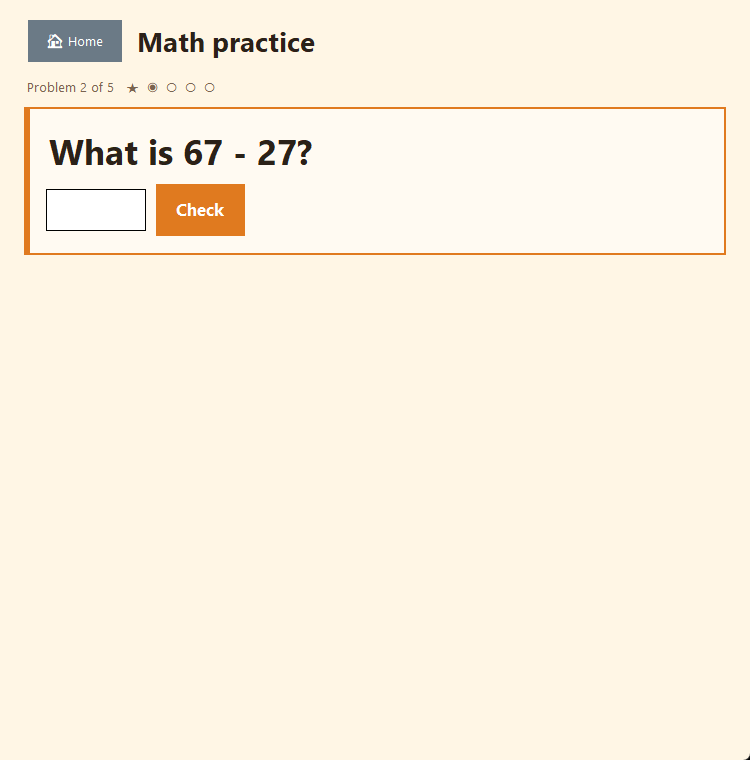 Math practice</td>
<td>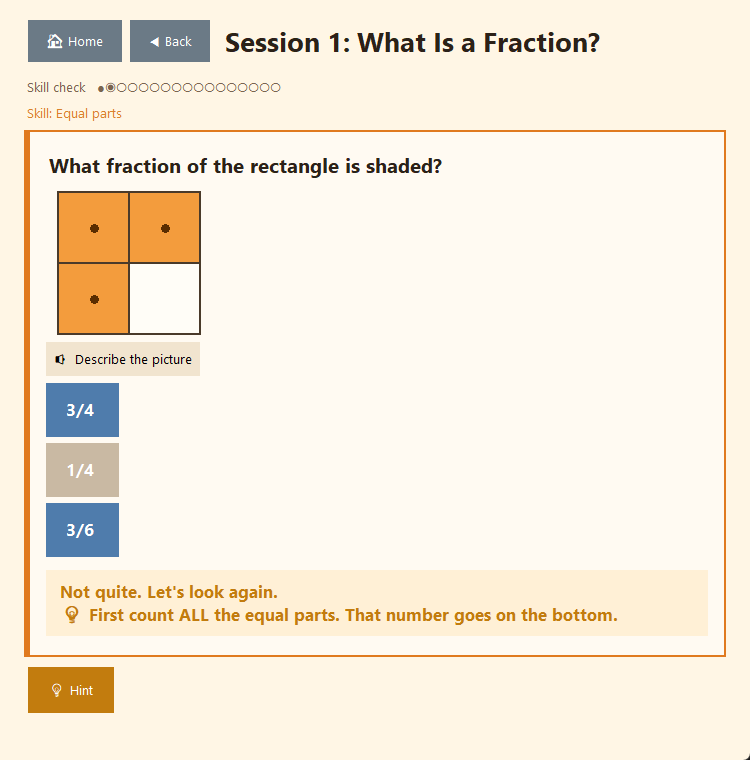 A fractions question with a hint after a wrong answer</td>
</tr>
<tr>
<td>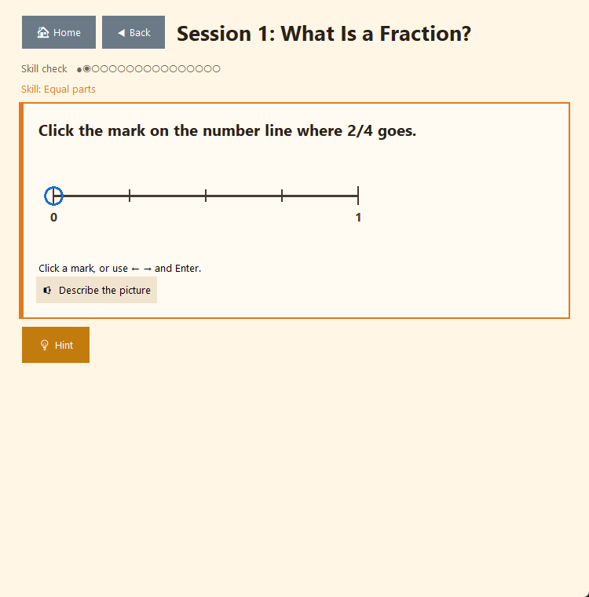 Number lines</td>
<td>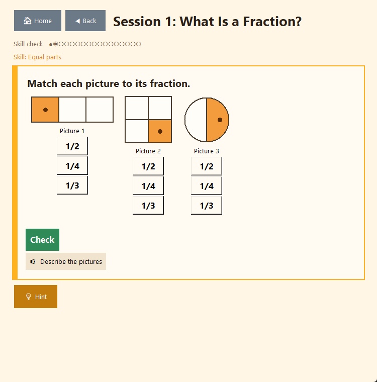 Matching fractions to pictures</td>
</tr>
</table>

### Learning Library (parent view)

<table>
<tr>
<td width="50%">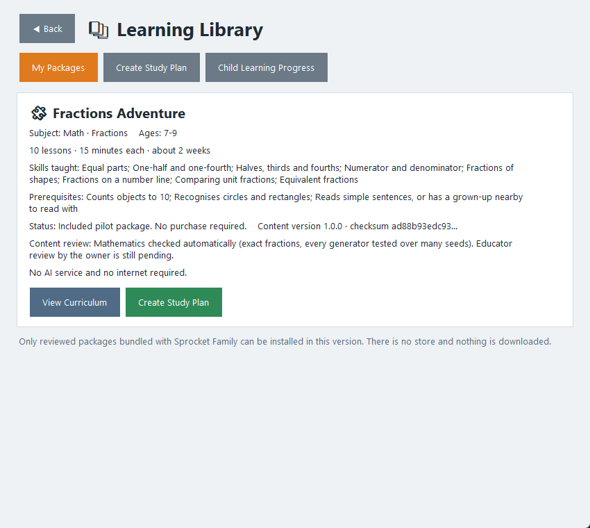 My Packages</td>
<td width="50%">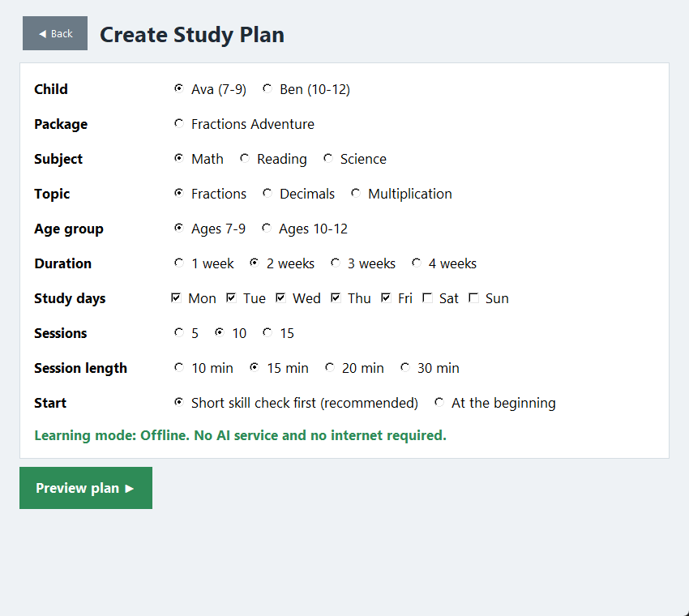 Study Plan builder</td>
</tr>
<tr>
<td>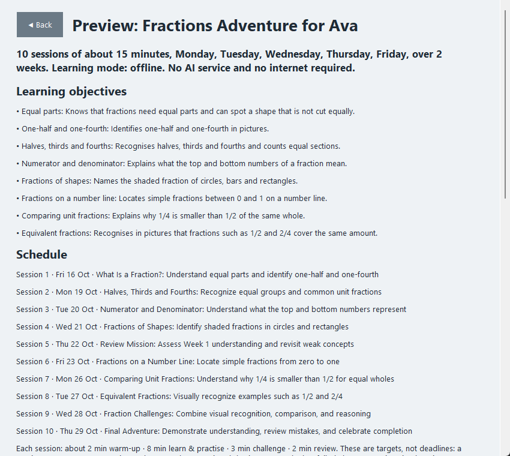 Preview before the parent approves</td>
<td>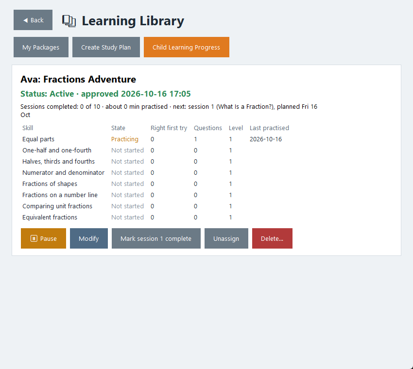 Skill-by-skill progress and plan controls</td>
</tr>
</table>

### Sprocket Desktop

<table>
<tr>
<td width="50%">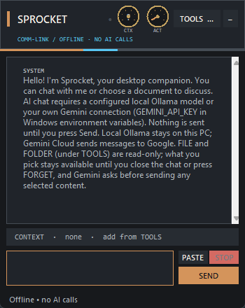 The Comm-Link chat window, in Offline mode</td>
<td width="50%">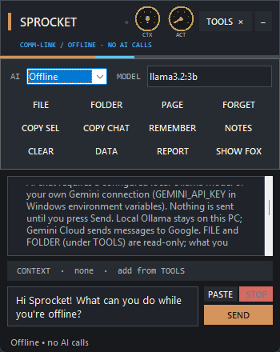 The TOOLS tray: everything Sprocket can work with, chosen by you</td>
</tr>
</table>

About these images: genuine, unedited screen captures, cropped to the app's own screens. The provider choices shown come from a development build and may differ in the release. [How they were made](media/screenshots/README.md)

## What makes Sprocket different

- **A character, not a chat box.** Sprocket moves, looks around and reacts. In Sprocket Family she takes part in the lesson: her motions suit what's happening, and she never repeats the same one twice in a row.
- **Her personality gives her no extra access.** An animation or a confident reply is never proof that something happened, and never permission to do more.
- **Permissions you can see.** Files are read only when you choose them, read-only, and only for the conversation you chose them for. FORGET clears them.
- **Built to grow without disruption.** Content and add-ons are designed as separate, checked packages, so new learning material or capabilities can arrive without rewriting the app you already have.

## Local-first by design

- **Desktop:** conversations, notes and settings stay on your PC. Local AI runs on your own hardware. Offline mode makes no AI calls at all.
- **Family:** the child edition works entirely offline. It contains no network code, cloud AI, analytics, advertising or purchases. Profiles use nicknames, chat text is never saved, and children can't reach the parent settings.
- **No hidden telemetry** in either edition.

These describe how the current development builds work. They are not yet independently audited or certified.

## Learning Library and study plans

The Learning Library is **implemented in the Sprocket Family development prototype** and is in owner testing. It lets a parent add learning content without waiting for an app update:

1. **Browse packages.** The first is **Fractions Adventure**: 10 sessions of about 15 minutes for ages 7–9, included with the prototype.
2. **Build a plan.** Choose the child, subject, topic, length, study days and session length. If a choice isn't supported, the builder says why and suggests alternatives; it never makes up lessons.
3. **Preview, then approve with the parent PIN.** Until a parent approves it, the child can't see the plan. If the plan or the package changes, it needs approving again.
4. **Sprocket teaches it offline.** New practice questions are made on the computer from reviewed question types (shaded shapes, number lines, comparing fractions, equivalent fractions and more). Every answer is checked with exact arithmetic before Sprocket reacts.
5. **Follow progress by skill.** Each skill shows Not started, Practicing, Developing or Demonstrated. One lucky answer never counts as mastery. Difficulty adjusts gently, with hints, worked examples and no penalties.

There's no package store, no purchasing and no downloading of packages yet. More packages and subjects are planned, but none is available yet.

## Development milestones

These are internal development results from Fenton Lab's own automated tests, **not independent certification**.

| Milestone | Status | Internal evidence |
| --- | --- | --- |
| Sprocket Desktop: animated companion, Comm-Link chat, local memory, read-only file help | Working pre-release build (0.7.5) | 133-file build fingerprint checked |
| Desktop updates and recovery (U3) | Isolated development copy only; **not deployed** | 399 passed, 1 skipped, of 400 automated tests, run twice |
| Windows installer | Test installer built; **not yet installed or tested** on clean machines | Signing and licensing still open |
| Sprocket Family: profiles, parent dashboard, time limits, lessons, coding, homework help | Working prototype in owner testing | Automated test suite |
| Family: Sprocket's teaching reactions and motion variety | Working in the prototype | Real-window recordings; automated tests |
| Family: Learning Library, Study Builder, Fractions Adventure | Working in the prototype, in owner testing | 137 automated tests pass (Oct 16, 2026), including 12,000 generated fraction questions checked with exact arithmetic |
| Child-safety, privacy and accessibility reviews | **Not started** | — |
| Public release | **Not announced** | — |

More detail: [Development status](docs/DEVELOPMENT_STATUS.md) · [Release requirements](docs/V1_RELEASE_GATES.md)

## Liberty, The Desktop Eagle

*Early development, further from release than Sprocket.* Liberty is Fenton Lab's second companion, a separate application with her own identity and memory. **What works today:** her desktop window and animation system (development milestone 0.2), shown for now with placeholder graphics.

Her planned signature capability is **Patriot Lens**. You deliberately select part of your screen, then choose **Research This**, **Explain This**, **Debug or Improve**, or **Teach Me About This**, and the conversation keeps only the context you allow. It's designed to work locally first, look at your screen only with your consent each time, keep its own memory, and never read files or run anything without your permission.

**AI chat, screen research and the final eagle animations are not finished.** [Read more about Liberty](docs/LIBERTY.md)

## Coming next

These are plans, **not available features**:
- **Pocket Workshop:** optional add-on devices, tools and animations for Sprocket Desktop.
- **New Sprocket motions:** a book, pointing, a pencil, tools, stretches and more celebrations, once the new artwork is cleared.
- **More Learning Library packages and subjects** for Sprocket Family.
- **Living Worlds:** optional desktop scenes, still a [design proposal](docs/SPROCKET_LIVING_WORLDS_ASSET_CONTRACT_V1.md).
- **Liberty:** Patriot Lens, AI chat and final eagle artwork ([details](docs/LIBERTY.md)).

## Availability

**Coming Soon: Windows release in preparation.** There is no download, Microsoft Store listing, waitlist or checkout yet. Before release we still need:
- commercial clearance for the character artwork;
- a verified, signed Windows package, tested on clean machines;
- the applicable Microsoft Store requirements;
- a published privacy policy and support contact;
- for Sprocket Family, child-safety and privacy reviews;
- final approval to release.

The planned model is a one-time purchase for Sprocket Desktop, with free character and motion updates for existing owners. Optional add-ons and learning packages may be offered later. **Pricing and dates aren't set.**

## Follow development

- ⭐ **Star or watch this repository** to see updates as they're published.
- 💬 **Questions and feedback:** [GitHub Issues](https://github.com/scottymicfree/Sprocket-AI-Companion/issues). Please don't post personal information there.
- 🔒 **Security concerns:** see the [security policy](SECURITY.md).
- **Fenton Lab on GitHub:** [scottymicfree](https://github.com/scottymicfree)

These are the only official channels right now. A website, social media accounts and a business contact will be added here once they are set up and confirmed.

**For partners, distributors and press:** [Fenton Lab overview](docs/FENTON_LAB_OVERVIEW.md) · [Press and partner overview](docs/PRESS_AND_PARTNER_OVERVIEW.md)

## Further reading

- [Fenton Lab overview](docs/FENTON_LAB_OVERVIEW.md)
- [Press and partner overview](docs/PRESS_AND_PARTNER_OVERVIEW.md)
- [Sprocket Family](docs/SPROCKET_FAMILY.md)
- [Liberty, The Desktop Eagle](docs/LIBERTY.md)
- [Engineering approach](docs/ENGINEERING_APPROACH.md)
- [Unified product plan](docs/UNIFIED_PRODUCT_PLAN.md)
- [Development status](docs/DEVELOPMENT_STATUS.md)
- [Product FAQ](docs/FAQ.md)
- [Architecture](docs/ARCHITECTURE.md)
- [Repository policy](docs/REPOSITORY_POLICY.md)

This is Fenton Lab's public product page. The application source and character artwork are private and not licensed for reuse.

---

<b>Fenton Lab</b> · Local-first by design · Evidence before claims

